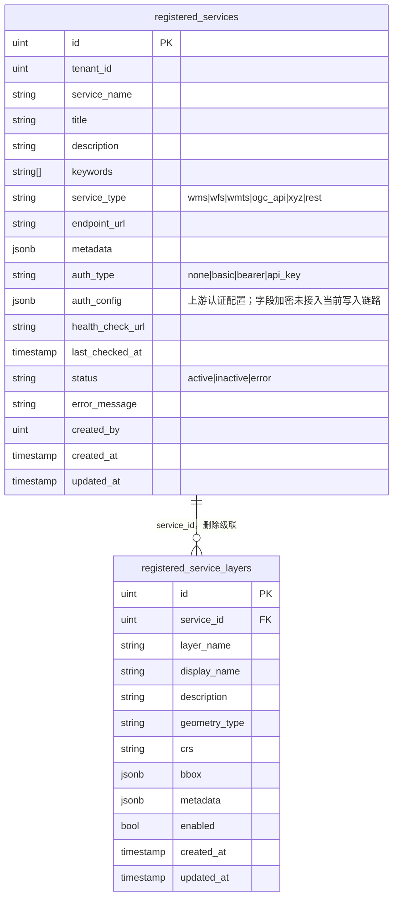

# Service 模块数据库架构

Service 使用 PostgreSQL 的 `service` schema，保存数据服务定义、外部服务注册信息及模块运行配置。本页说明当前表、对象关系和存储边界；完整字段以[模型目录](../backend/internal/models/)及[数据库初始化与迁移入口](../backend/internal/repository/database.go)为准。

阅读导航：[模块与表清单](#模块与表清单)、[注册服务关系图](#注册服务关系图)、[字段与约束](#字段与约束)、[写入与读取流程](#写入与读取流程)、[认证与访问边界](#认证与访问边界)、[待核对事项](#待核对事项)。

## 模块与表清单

服务发布覆盖查询、图查询和瓦片服务；注册服务保存第三方端点及其能力元数据。对象职责以 [Service 模块说明](../CLAUDE.md)为准。

| 表 | 对象与职责 |
| --- | --- |
| `service.query_services` | [表说明](tables/query_services表.md)。QueryService；保存 `table`、`sql` 或 `analytical` 来源、协议、消费契约和版本。发布快照由 `data_config` 保存；analytical 来源冻结 Model 指标实现修订及计划包。 |
| `service.graph_query_services` | GraphQueryService；保存图引擎、数据库、`shape` / `cypher` 来源及参数、输出配置。 |
| `service.tile_services` | [表说明](tables/tile_services表.md)。TileService；保存瓦片服务信息、范围、协议及访问设置。 |
| `service.tile_service_layers` | [表说明](tables/tile_service_layers表.md)。TileServiceLayer；以 `service_id` 归属瓦片服务，保存 `dynamic` / `static` 图层配置及显示顺序。 |
| `service.registered_services` | [表说明](tables/registered_services表.md)。RegisteredService；保存第三方服务端点、认证配置、能力元数据、健康检查状态和审计字段。 |
| `service.registered_service_layers` | [表说明](tables/registered_service_layers表.md)。RegisteredServiceLayer；以 `service_id` 归属注册服务，保存从上游能力解析的图层信息。 |
| `service.runtime_policy` | Service 自有的平台级运行配置；单行 `id=1`，保存健康检查与元数据刷新 Cron、版本和修改人。 |
| `service.catalog_resource_changes` | Service 本地的可重放变化流；当前仅发布 QueryService 的最小目录摘要，不保存企业目录身份或治理事实。 |
| `service.data_migrations` | PostgreSQL 数据迁移版本账本；由迁移入口创建，保存版本、名称和应用时间。 |

[AutoMigrate](../backend/internal/repository/database.go)登记上述八个模型，并调用 analytical 发布迁移与 Catalog 变化流迁移；`data_migrations` 是迁移账本。历史 SQL 文件不能替代当前启动迁移入口，也不能仅凭列注释确认运行能力已经实现。

Engine 连接配置归 System；企业 Catalog 身份和治理事实归 Catalog。Service 保存服务专业定义和必要的 owner 引用，不保存 `catalog_entry_id` 反向副本。APIConsumer 及其凭据归 System；它们与注册服务调用上游时使用的 `auth_config` 是不同事实。

## 注册服务关系图

下图列出当前注册服务模型字段；其他服务的业务关系见[平台 Service 元模型](../../docs/concepts/meta-model/Service.md)。图中的关联不替代具体数据库约束检查。

## 字段与约束

### 身份、租户与删除

- `service_name` 是程序标识，`title` 是显示标题，`endpoint_url` 是上游服务地址；注册服务图层使用 `layer_name` 和 `display_name`。不把显示名或 URL 当作服务 ID。
- 注册服务拥有 `tenant_id`；图层没有独立的 `tenant_id`，必须先校验所属服务的当前 Tenant，再读取或修改其图层。
- 管理详情与更新、删除使用 `id + tenant_id` 条件；名称查询与查重使用 `service_name + tenant_id`。租户来自当前 AuthContext，Platform Context 不能借普通 Repository 跨 Tenant 管理。
- 注册服务与图层的 GORM 模型没有 `DeletedAt`；当前 Repository 删除的是物理记录，没有软删除、回收或恢复流程。`inactive` 和图层 `enabled=false` 是状态标记，不提供删除或恢复语义。
- `RegisteredService.Layers` 声明 `service_id` 外键及 `OnDelete:CASCADE`，删除服务时级联删除所属图层。图层唯一键由 `service_id + layer_name` 组成；服务名的应用查重与数据库约束范围差异见[待核对事项](#待核对事项)。

### JSONB 的职责

| 字段 | 保存的事实与使用边界 |
| --- | --- |
| `registered_services.metadata` | 上游能力文档、解析出的服务信息及刷新时间；具体结构由 WMS、WFS、WMTS、OGC API 解析路径决定。REST / XYZ 不因注册就自动形成 GetCapabilities 图层。 |
| `registered_services.auth_config` | `auth_type` 对应的上游调用参数；当前 JSONB 编解码只是 JSON 序列化，不是字段加密。 |
| `registered_service_layers.bbox` | 协议解析得到的边界框对象。WMS 常使用 `west/east/south/north`，WMTS 使用 `minx/miny/maxx/maxy`；不能将所有记录一律解释为四元素数值数组。 |
| `registered_service_layers.metadata` | 图层特有能力，例如 WMS 样式、是否可查询或 WMTS TileMatrixSet；它不替代图层稳定身份。 |

几何类型、CRS 和边界框来自上游可解析事实；缺失时不补造。WMS 当前以 `Unknown` 表达未提供的几何类型，WMTS 使用 TileMatrixSet 表达切片坐标体系，不能据空 `crs` 推断默认坐标系。

### 索引与读取

当前注册模型声明以下索引，具体创建结果由迁移验证：

| 表 | 索引声明 |
| --- | --- |
| `registered_services` | `idx_registered_services_tenant`、`idx_registered_services_type`、`idx_registered_services_status`、`idx_registered_services_metadata_gin`；另有 `unique_registered_service_name` 唯一索引声明。 |
| `registered_service_layers` | `idx_registered_layers_service`、`idx_registered_layers_enabled`、`idx_registered_layers_metadata_gin`；另有 `unique_service_layer` 复合唯一索引声明。 |

Repository 按当前 Tenant 查询主表，并通过 `Preload("Layers")` 读取图层；详情先限定 `id + tenant_id`。列表按 `created_at DESC` 排列，名称/标题搜索使用 `ILIKE`，统计与分页仍由 Repository 执行。普通注册列表查询不承诺仅加载启用图层；限定 `enabled=true` 的读取使用对应图层查询方法。

这里保留查询行为和索引事实，具体 SQL/GORM 写法以[注册服务 Repository](../backend/internal/repository/registered_service_repository.go)为准，避免文档维护第二套查询实现。

## 写入与读取流程

### 注册与元数据刷新

1. 创建请求先在当前 Tenant 检查名称，保存注册记录与初始 `active` 状态，再重新读取服务返回 DTO。
2. 只有 `auto_refresh_metadata=true` 且为支持的 OGC 类型时，创建流程才异步刷新；创建返回不保证图层已经齐备，异步刷新失败只记录日志，不回滚已保存的服务。
3. 手动刷新先按 `id + tenant_id` 读取服务，再请求上游能力。WMS / WFS / WMTS 获取 GetCapabilities；OGC API 读取 collections，不为普通 REST 服务虚构 API 文档解析能力。
4. WMS 当前先更新服务元数据，再删除旧图层并逐条创建新图层；WFS / WMTS 按图层名称更新或新增。OGC API 当前把 collections 响应保存到服务元数据，不保证为每个 collection 创建独立图层记录。
5. 手动刷新入口成功时回写 `active`，失败时尝试回写 `error` 和错误信息。部分图层写入错误仅记录日志，不能把一次刷新返回成功等同于所有图层均已写入。

服务创建、上游 HTTP 请求与多条图层写入没有包在同一个数据库事务中。现有 `DeleteLayersByServiceID` 与后续创建是分步操作；失败可能保留已更新元数据或部分图层，不能承诺原子替换和失败自动恢复。具体流程见[注册服务 Service](../backend/internal/service/registered_service_service.go)。

### 健康检查与定时刷新

- Service 启动时读取本模块 `runtime_policy`；未持久化配置时，健康检查默认 `0 * * * *`，元数据刷新默认 `0 2 * * *`。持久配置更新按重启生效处理，不能把默认值当成所有环境的固定频率。配置所有权遵循[平台配置规范](../../docs/spec/addp配置介绍.md)。
- 定时入口仅在模块已注册时执行，按 Tenant 读取 `status=active` 的注册服务；当前主循环逐项串行处理服务。`error` / `inactive` 服务不因这条定时循环自动重试，仍可由管理入口手动检查。
- 手动检查同样先限定 `id + tenant_id`。优先访问 `health_check_url`；为空时，WMS / WFS / WMTS 构造 GetCapabilities 请求，其他类型使用 `endpoint_url`。
- 当前健康请求超时为 10 秒，并按 `auth_type` 添加上游认证。2xx 对应 `healthy`；非 2xx 或请求失败对应 `unhealthy`，构造请求失败对应 `error`。
- 健康结果的 `healthy/unhealthy/error` 与服务持久状态是两套含义：健康时尝试回写 `active`，其余结果尝试回写 `error`，并尝试更新 `last_checked_at`。超时不自动改为 `inactive`；这些回写错误当前未向调用方完整传播，不能承诺检查响应和持久状态严格一致。

调度装配以[服务启动入口](../backend/cmd/server/main.go)和[运行配置 Service](../backend/internal/service/runtime_policy_service.go)为准。这里的固定模块维护调度不等于对外声明 TaskProvider 任务。

### 代理读取

公开代理按注册服务 ID 读取配置，将请求方法、路径、查询参数和请求体发送到保存的 `endpoint_url`，由服务端添加上游认证，再流式返回响应。当前公开代理请求超时为 60 秒。

转发前过滤客户端 `Authorization`、`Host` 和 `Cookie`，再由 `addAuthToRequest` 装配上游认证。当前代理审计辅助方法只写应用日志，尚未提交到 System 审计 API，不能据此承诺统一审计已经接通。

## 认证与访问边界

### 上游认证配置

| `auth_type` | `auth_config` 与当前使用方式 |
| --- | --- |
| `none` | 不添加上游认证。 |
| `basic` | 读取 `username`、`password`，构造 Basic Authorization。 |
| `bearer` | 读取 `token`，构造 Bearer Authorization。 |
| `api_key` | 读取 `key`、`name`、`location`；`location=header` 写指定 Header，`location=query` 写查询参数。 |

管理 DTO 返回 `auth_type` 和 `has_auth_config`，不返回 `auth_config` 正文；仍会返回 `endpoint_url` 和原始端点，因此不能声称上游 URL 对前端完全隐藏。隐藏 DTO 中的凭据与数据库中是否加密是两件事。

当前创建、更新直接保存 `auth_config`，`JSONB.Value()` 调用 `json.Marshal`，读取后直接用于上游请求；该链路没有字段加解密步骤。历史 SQL 中的“加密存储”注释不是 AES-256-GCM 已实现的证据，也不能据此宣称 `ENCRYPTION_KEY` 已用于注册服务凭据。敏感配置的存储保护仍须单独确认。

### 管理面与公开代理

- 管理面执行 `service.external_registration.*` 的精确 Permission 与 Tenant 校验；这不等于注册服务的所有消费入口都具有相同校验。
- 当前 Service Router 将注册服务代理单独公开挂载，`ProxyServiceRequest` 使用不带 Tenant 条件的 `GetByID`，该读取也不按服务 `status` 筛选。传入 Tenant/User 值用于日志，不构成该公开端点的资源授权；不能把管理 Repository 的租户隔离推导为公开代理已登录认证或按租户隔离。
- 代理只读取已注册的端点，但登记记录本身不证明 URL 安全。当前调用路径未见完整的内网地址、DNS 重绑定或重定向目标约束，不能声明已实现 SSRF 防护；服务注册资格也不代替目标网络访问限制。

这些是当前路径的边界说明，不是新增的认证或代理方案。统一认证与凭据分类见[API 认证与授权规范](../../docs/spec/api/认证授权.md)。

## 待核对事项

| 事项 | 现有依据与未确认范围 |
| --- | --- |
| 服务名唯一范围 | Repository 按 `tenant_id + service_name` 查重；历史建表 SQL 也声明这一复合唯一约束，但当前 GORM `unique_registered_service_name` 只标注在 `service_name`。需确认实际约束和跨 Tenant 同名策略，不能仅凭应用查重断言数据库保证租户内唯一。 |
| 刷新一致性与失败恢复 | 当前分步更新元数据和图层；原子替换、并发刷新及失败补偿尚需单独确认，不能使用示意事务代码充当实现证据。 |
| 注册服务凭据保护 | 当前字段写入与读取链路没有加解密；存储保护、密钥归属与轮换方式须先确认后实施，不从查询游标等其他加密用途推导已经覆盖。 |
| 公开代理授权与网络边界 | 需要独立确认允许的调用主体、服务范围、上游目标及重定向策略，并核对正式审计接入；不能沿用“必须登录”“已防 SSRF”的既成结论。 |

扩展服务类型或认证方式时，应同时核对请求校验、模型约束、能力解析、代理装配和管理 DTO；只增加枚举或未接线的示例函数不代表能力已经可用。当前服务类型不包含 GeoPackage，上游认证类型不包含 OAuth2。

## 相关文档

- [Service 模块说明](../CLAUDE.md)：当前模块职责、管理入口和验证方式。
- [平台 Service 元模型](../../docs/concepts/meta-model/Service.md)：服务与图层的业务对象关系。
- [注册服务模型](../backend/internal/models/registered_service.go)、[注册服务 Repository](../backend/internal/repository/registered_service_repository.go)、[注册服务 Service](../backend/internal/service/registered_service_service.go)：字段与实现事实。
- [运行配置模型](../backend/internal/models/runtime_policy.go)：平台级配置范围与版本。
- [数据库初始化与迁移入口](../backend/internal/repository/database.go)：当前表登记、数据迁移和目录变化捕获。
