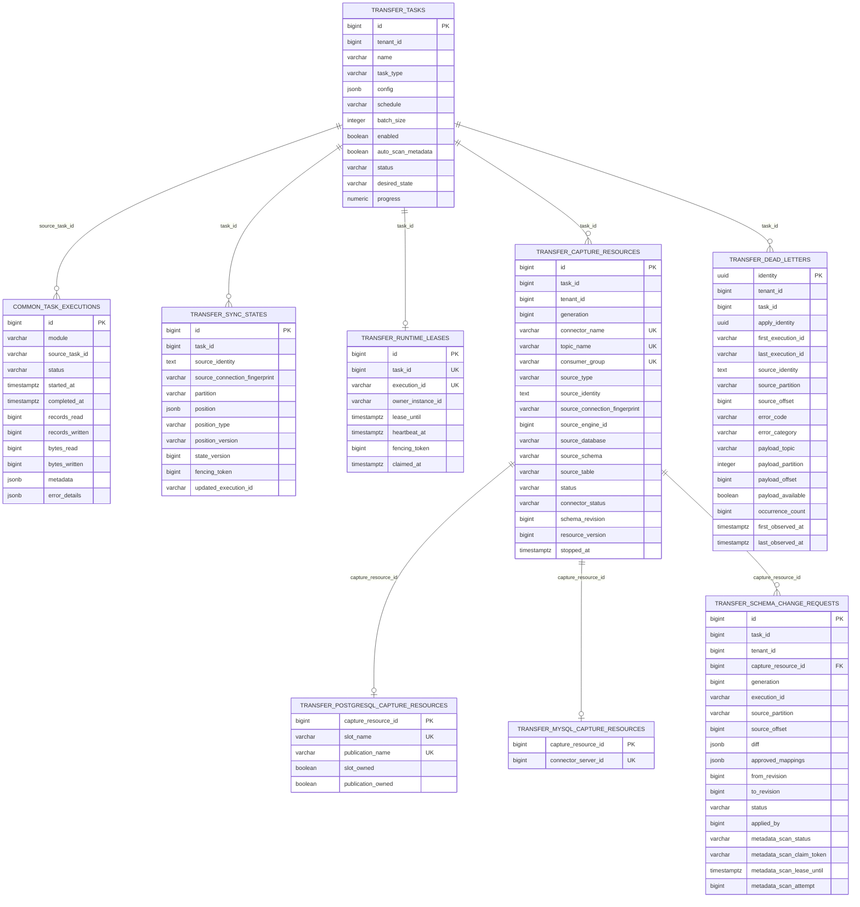

# Transfer 模块数据库架构

更新时间：2026-11-02

Transfer 模块保存传输任务定义和增量同步 committed position。引擎身份统一来自 System engine，执行记录统一写入 `common.task_executions`，不再维护 Transfer 私有执行历史主表或私有引擎表。

阅读导航：[执行记录与公开响应](#四执行记录存储)、[同步状态与租约](#五同步状态与-checkpoint-语义)、[execution 与 attempt 恢复分工](tables/task_executions表.md#execution-与-attempt-的恢复分工)、[恢复审计字段](tables/task_executions表.md#自动恢复字段与安全-dto)、[Capture 持久字段与安全投影](#capture-观测与公共安全投影)、[结构审批与补扫](#七cdc-schema-change-request)、[DLQ 索引与公开查询](#八业务-kafka-dead-letter-控制索引)、[验证导航与恢复验收](#持久化与恢复验收)。

## 一、表清单

| 表 | 所属 schema | 用途 |
|---|---|---|
| `transfer.transfer_tasks` | `transfer` | Transfer 任务定义，核心配置在 `config` JSONB。 |
| `transfer.sync_states` | `transfer` | 增量同步主状态；按 task/source/partition 保存 position、CAS version 和 fencing token。 |
| `transfer.runtime_leases` | `transfer` | continuous runtime 所有权、heartbeat、lease deadline 与 fencing token。 |
| `transfer.capture_resources` | `transfer` | 数据库 CDC 的 engine-neutral capture generation、connector/topic/group、源身份、状态与清理版本。 |
| `transfer.postgresql_capture_resources` | `transfer` | PostgreSQL generation 独有的 ADDP-owned slot/publication 资源事实。 |
| `transfer.mysql_capture_resources` | `transfer` | MySQL generation 独有的 Debezium connector server id 与 owned schema-history topic。 |
| `transfer.oracle_capture_resources` | `transfer` | Oracle generation 独有的 owned schema-history topic；表级 supplemental logging 不属于 generation。 |
| `transfer.schema_change_requests` | `transfer` | 数据库 CDC 人工 additive migration 的阻塞位置、schema diff、mapping revision、审批和 Meta scan 审计。 |
| `transfer.dead_letters` | `transfer` | 业务 Kafka dead-letter 查询/审计控制索引；原始 payload 仅保存在 Infra Kafka。 |
| `common.task_executions` | `common` | 统一执行记录表，Transfer 通过 `module=transfer`、`task_type=sync` 和 `source_task_id` 关联任务。 |

新增 Transfer 主链路不得重新引入私有 reader / writer 插件表、私有执行表或 Transfer 私有引擎路线。

## 二、关系图

## 三、任务配置存储

`transfer.transfer_tasks.config` 是任务配置事实，存储 source / target endpoint JSON；字段、可执行样例与映射配置统一见[Config JSON](transfer-基本概念及配置说明.md#二任务-config-json)、[field_mapping](transfer-基本概念及配置说明.md#五field_mapping-transform)及[任务表](tables/tasks表.md#二config-字段结构)。本节保留存储归属与旧表、旧字段退出后的约束。

旧 `source_id`、`target_id`、`connector_type`、`source_config`、`target_config`、`output_format`、`file_type`、`engine.scope` 等不再作为任务配置事实来源。
旧任务外层 `mappings`、`transfer.field_mappings` 和 `transfer.data_mappings` 已退出主路径；字段映射只写入 `config.transforms[type=field_mapping]`。退出约束见[旧映射表删除说明](tables/data_mappings表.md)。

## 四、执行记录存储

Transfer 创建执行时写入 `common.task_executions`。这里的 `task_type=sync` 是对外 TaskProvider 和统一 execution 类型；`transfer.transfer_tasks.task_type` 也是任务定义侧字段，固定为 `sync`。导入、导出是 Manager 等调用方的用户动作语义，不作为 Transfer 任务类型。

| 字段 | Transfer 用法 |
|---|---|
| `module` | 固定为 `transfer`。 |
| `task_type` | 固定为 `sync`。 |
| `source_task_id` | 有定义执行按十进制字符串软引用 `transfer.transfer_tasks.id`；模块一次性执行为空，不创建临时任务定义，来源规则见[执行记录表说明](tables/task_executions表.md#一关联规则)。 |
| `status` | 取值与含义见公共[执行状态枚举](../../docs/spec/tasks/执行记录与租约.md#执行状态枚举)。 |
| `records_read` / `records_written`、`bytes_read` / `bytes_written` | table Transfer 与 raw copy 的计数口径见[执行记录表的指标字段](tables/task_executions表.md#二指标字段)。 |
| `metadata.checkpoint_offset` / `metadata.checkpoint_state` | 持久观测与 marker，结构样例、口径与解释职责见[执行记录表](tables/task_executions表.md#三metadata-中的-checkpoint-字段)。 |
| `metadata` 中的恢复事实 | 本次恢复审计与可变运行状态；字段及重置边界见[恢复审计与部署配置](../../docs/spec/tasks/Transfer同步执行.md#恢复审计与部署配置)，持久字段与响应分工见[执行记录表](tables/task_executions表.md#自动恢复字段与安全-dto)。 |
| `error_details` | 持久错误事实；不等同于可以公开返回的错误正文。 |

`metadata.execution_logs` 和 `error_details.logs` 属于单向迁移删除的历史字段，迁移事实、现行过程事件与错误存储统一见[表说明](tables/task_executions表.md#四执行过程事件和错误)。

HTTP 专业响应使用显式安全 DTO，不直接返回原始 checkpoint、任意 metadata 或自由文本错误；字段与敏感信息排除以[专业读取契约](../../docs/spec/tasks/执行监控.md#transfer-专业执行读取与响应)为准，恢复字段与响应的分工见[表说明](tables/task_executions表.md#自动恢复字段与安全-dto)。用户读取、模块结果与 TaskProvider 的身份、权限及来源范围分别核验，入口见[API 归属](tables/task_executions表.md#六api)。持久字段不能因存在于数据库中就扩大响应或读取权限。

## 五、同步状态与 Checkpoint 语义

checkpoint 与同步主状态的区别统一见[状态所有权](transfer-任务语义与同步模式.md#五状态checkpoint-与-replay)；snapshot checkpoint 仅可观测，不表示断点续写。本节维护同步主状态、运行租约与目标账本的持久约束，metadata 结构样例与公开字段边界见[执行记录表](tables/task_executions表.md#三metadata-中的-checkpoint-字段)。

execution 身份、attempt 与时间重置统一见[恢复分工](tables/task_executions表.md#execution-与-attempt-的恢复分工)，snapshot／watermark 的支持范围、非空间限制、稳定键和幂等条件见[Bounded 执行语义](transfer-任务语义与同步模式.md#四bounded-执行语义)，重试准入与恢复位置见[执行记录表](tables/task_executions表.md#恢复类型与位置)。continuous 领取与退避见[运行时专题](transfer-任务语义与同步模式.md#自动恢复与退避)，底层约束以[自动恢复契约](../../docs/spec/tasks/Transfer同步执行.md#continuous-自动恢复退避与-circuit)为准。恢复仍须遵守下文 CAS、lease 与 fencing 约束。

`transfer.sync_states.position` 第一版为 `type=watermark`、`version=v1`，cursor values 是由 PostgreSQL/MySQL/OceanBase/openGauss/TiDB 源 Provider 解释的 canonical string 数组。每批目标 upsert 事务成功后，Transfer 才使用 `state_version + fencing_token` 做 CAS 提交；旧 worker 或并发 execution 无法覆盖新位置。

Kafka continuous 同样复用 `transfer.sync_states`，但按 topic partition 分行保存 `type=kafka_offset`、`version=v1`、`next_offset`。该 position 表示下一条应消费的 offset；consumer group auto commit 不是事实源。

continuous task 还必须持有服务端生成、不可修改且不写入 config 的 `apply_identity UUID`。该身份跨 execution 保持不变，删除并重建任务时重新生成；业务目标 PostgreSQL 使用它隔离目标应用账本，不能只使用可能在其他 ADDP 实例重复的本地自增 task ID。

业务目标 PostgreSQL 由 `PartitionedTableChangeApplyProvider` 准备 `addp_transfer.apply_positions`。账本至少保存 `apply_identity`、`source_identity`、`target_identity`、`partition`、`position_type`、`position_version`、`next_offset` 和审计时间。每次只应用单 partition batch，在同一事务中锁定 ledger、过滤已应用 offset、按目标 key 保留最后状态、upsert 业务表并推进 ledger。该表位于业务目标库，不得建在 Infra PostgreSQL，也不得用业务表隐藏 offset 列替代。

### 运行租约字段与 fencing

`transfer.runtime_leases` 已由迁移 `013_add_continuous_runtime.sql` 建立，保存 continuous runtime session 的 task、execution、owner instance、lease deadline、heartbeat 和 fencing token；不得把 lease 写入 position JSON，也不得用 execution heartbeat 代替业务 committed position。

正式字段如下：

| 字段 | 语义 |
|---|---|
| `id` | lease 自增 ID。 |
| `task_id` | continuous task ID，必须唯一，保证同一 task 只有一个当前 lease。 |
| `execution_id` | 当前 runtime session 对应的 execution UUID。 |
| `owner_instance_id` | continuous worker 实例稳定 ID。 |
| `lease_until` | 当前 owner 的租约截止时间。 |
| `heartbeat_at` | 最近一次成功续租时间。 |
| `fencing_token` | 每次合法 claim 单调递增的 token。 |
| `claimed_at` | 本次 session 首次 claim 时间。 |
| `created_at` / `updated_at` | 审计时间。 |

claim pending execution、写入 owner、推进 lease 和递增 fencing token 必须在同一数据库事务中完成。session 首次接管 partition state 时，必须把相同 fencing token 写入对应 `transfer.sync_states` 行；后续 position CAS 同时校验 `state_version + fencing_token`。过期 owner 即使稍后恢复，也不能推进新 session 的 position。

### 任务状态与 CDC 阻塞收敛

用户期望 `desired_state`、实际任务 `status`、最近 execution status 与 bounded 的区别统一见[期望与实际运行状态](../../docs/spec/tasks/Transfer同步执行.md#用户期望与实际运行状态)，运行控制与 execution/session 关系见[执行身份契约](../../docs/spec/tasks/Transfer同步执行.md#运行控制与执行身份)。

CDC schema drift 时，`desired_state=running` 可与实际 `status=blocked` 并存；当前消息和 committed offset 不得推进，start/resume/retry 均拒绝。只有 pending additive schema change request 审批成功后可收敛为 `status=idle, desired_state=paused`；其他变化 Stop 后状态回到 `idle` 且 generation 永久失效。

运行控制、容量和协议处理统一见[Continuous 运行时](transfer-任务语义与同步模式.md#六continuous-运行时)，本节保留租约、位置与目标账本的持久边界。pause/stop 的实际 runtime 关闭、execution 终态与 lease 释放顺序沿[真实停止契约](../../docs/spec/tasks/Transfer同步执行.md#continuous-的真实停止)；旧 owner 在 desired state 变化或 lease/fencing 失效后不能继续推进 position。PostgreSQL 目标库 `addp_transfer.apply_positions`、MySQL 目标库 `_addp_transfer_apply_positions` 与 Infra 库 `transfer.sync_states` 保持不同事实边界，禁止混用。

### 持久化与恢复验收

持久结构、已记录 position、marker 或恢复审计不代表真实恢复与幂等性已验收。User 读取、模块结果来源隔离与 TaskProvider 机器读取须分别按其身份核对；快照重跑、增量续读、continuous 恢复及实际目标数据的判定由[执行记录表验证边界](tables/task_executions表.md#验证边界)维护，测试分层与公共入口遵循[测试与验收规范](../../docs/spec/addp测试与验收规范.md#三标准入口)。

| 阅读目的 | 权威入口与范围 |
| --- | --- |
| 模块、Go 定位、PostgreSQL 持久化与 Hosted runner 回归 | [README 标准门禁](../README.md#常规模块与专项门禁)：统一维护命令、实际测试连接、凭据注入与本地 `addp_test` 隔离要求；Go 子集、runner 回归与完整模块门禁分别认定。 |
| Oracle CDC 数据面与故障专项 | [标准入口缺口](../README.md#oracle-cdc-专项入口缺口)：保留两类用例的源／目标范围、环境前提、授权故障窗口与恢复清理要求，普通门禁成功或专项跳过不能证明这些实测通过。 |
| 固定版本、有效证据、失败与修复、清理及未覆盖项 | [分版本证据索引](../CLAUDE.md#专项约束与分版本证据)：历史结果仅适用于所列源码与运行尝试，不作为当前 HEAD 已重跑的证明。 |

各章保留自身的事务、权限、claim、传输来源与扫描结果断言；标准门禁或静态存储说明不替代真实 System → Gateway → Owner／Worker 授权链路、目标数据、恢复或清理验收。未运行、失败、跳过或未覆盖项不计为通过。

## 六、CDC Capture Generation 与资源登记

`transfer.capture_resources` 由迁移 `014_add_capture_resources.sql` 建立，并由 `015_add_capture_source_spatial_info.sql` 增加源空间事实。迁移 `017_split_capture_provider_resources.sql` 将它 clean break 为 engine-neutral capture generation 主事实，并把 provider 私有资源拆到一对一子表；`021_add_oracle_capture_resources.sql` 增加 Oracle provider 子事实并将 `source_type` 收敛为 `postgresql|mysql|oracle`。每条 generation 按 `task_id + generation` 唯一，内部名称全部由服务端生成，不进入任务 JSON：

| 字段 | 语义 |
|---|---|
| `generation` | capture generation；start/retry/resume 复用当前 generation，stop 后永久失效。 |
| `connector_name` | ADDP-owned Debezium connector。 |
| `topic_name` | 单分区任务级 Infra Kafka CDC topic。 |
| `consumer_group` | Transfer CDC consumer group 名称登记；控制面 stop/cleanup 幂等删除其 offsets。 |
| `source_type` | capture provider，当前表结构只允许 `postgresql|mysql|oracle`；公开能力是否开放仍由 planner/API 契约决定。 |
| `source_identity` / `source_connection_fingerprint` / `source_*` | 源 Engine locator、非敏感 host/port/database 指纹、数据库、schema、table 的稳定清理身份；连接事实变化后拒绝按旧登记清理 provider 资源。 |
| `source_spatial_info` | generation 创建前从源表冻结的 geometry 字段名、OGC type、SRID、维度和 nullable；continuous worker 只能使用该事实校验 Debezium geometry，并按字段映射派生目标 `SpatialInfo`。 |
| `schema_revision` | 当前 generation 已提交的 field mapping revision，初始为 1；每次人工 additive migration 成功后递增 1。 |
| `status` | `provisioning|running|failed|cleaning|cleanup_failed|stopped`。 |
| `connector_status` / `connector_error` | Kafka Connect connector/task 最近观测状态与私有安全错误摘要，只表达复制线程；不能据此单独认定 generation 健康。 |
| `source_status` / `source_error` | 使用 connector 实际数据库凭据执行最小只读探针的最近状态与私有安全错误摘要；Oracle 使用独立 CDC 账号。 |
| `source_recovery` | provider-neutral、版本化的源事务日志恢复窗口观测 JSON，不替代 `source_status` 或 Infra Kafka retention；Oracle SCN、日志窗口和 FRA 指标口径见[源日志恢复窗口](../../docs/spec/tasks/Transfer数据库CDC.md#源日志恢复窗口)。 |
| `source_transactions` | provider-neutral、版本化的源未提交事务压力观测 JSON，不派生健康状态，也不替代 `source_recovery`；Oracle 事务与 Undo 指标口径见[源未提交事务压力](../../docs/spec/tasks/Transfer数据库CDC.md#源未提交事务压力)。 |
| `resource_version` | capture state CAS 版本，避免并发控制动作覆盖。 |

Provider 子事实的字段与关系如下；资源所有权、schema-history 策略与共享 source readiness 的保留规则统一见[捕获资源所有权与登记](../../docs/spec/tasks/Transfer数据库CDC.md#捕获资源所有权与登记)。

| 子表 | 独有持久字段 |
| --- | --- |
| `transfer.postgresql_capture_resources` | 由全局 apply identity／generation 派生的 `slot_name/publication_name`；ownership 初始为 false，同名只读核验通过后按 generation CAS 原子声明。 |
| `transfer.mysql_capture_resources` | Debezium `connector_server_id`、`schema_history_topic_name` 与 ownership；server id 由 capture generation 主键分配并通过唯一索引防冲突。 |
| `transfer.oracle_capture_resources` | `schema_history_topic_name`、Spatial 镜像表、行级触发器及 DDL guard 名称与相应 ownership。 |

三张子表都以 `capture_resource_id` 为主键并 `ON DELETE CASCADE`，不得在 generic 主表恢复 provider 字段，也不得用空字符串或伪资源名占位。

同事务登记后的外部资源[准备顺序](../../docs/spec/tasks/Transfer数据库CDC.md#捕获资源准备顺序)、[停止确认与清理顺序](../../docs/spec/tasks/Transfer数据库CDC.md#停止确认与清理顺序)及[保留对象与清理验收](../../docs/spec/tasks/Transfer数据库CDC.md#保留对象与清理验收)由 CDC 正式契约维护。外键级联只描述持久关系，不证明 connector、源端对象、topic/group 或 ACL 已清除；实际停止、失败与清理结果沿上述验收边界和[持久化验收](#持久化与恢复验收)分别核对。

### Capture 观测与公共安全投影

本表的连接身份、资源登记、状态与错误摘要属于 generation 持久事实，不作为公共 execution 响应清单。捕获健康、源日志恢复窗口和事务压力的分工统一见[诊断专题](transfer-任务语义与同步模式.md#捕获健康与源日志窗口)；冻结源身份、连接 fingerprint 复核及独立 CDC 账号探测以[CDC 正式契约](../../docs/spec/tasks/Transfer数据库CDC.md#捕获线程与源连接健康)为准，不能用 connector 线程 `RUNNING` 替代源数据库探测。

公共 `metadata.continuous.capture` 只保存已声明的 generation 与类型化恢复／事务观测安全摘要，字段允许范围与敏感信息排除统一见[安全投影与读取边界](transfer-任务语义与同步模式.md#安全投影与读取边界)及[continuous 正式契约](../../docs/spec/tasks/Transfer同步执行.md#transfer-continuous-sync-v1-契约)。私有错误、连接信息、凭据和 Provider 资源名不得因已保存为摘要而进入公共 execution；Monitor 仅消费公共投影，不读取 Capture 或 Provider 私表补判。

公共投影不额外授予读取权限；User、模块结果与 TaskProvider 的身份、Permission 和来源隔离沿[专业读取与权限说明](#四执行记录存储)。真实源探测、读取授权、响应安全裁剪及 Monitor 消费须分别核对，持久化或线程 `RUNNING` 不作为通过证据；标准入口、分版本证据与未覆盖项统一沿[持久化验收](#持久化与恢复验收)核对。

当前 capture generation 的 `buffer_observation` JSONB 保存任务消息缓冲的最近只读快照：消息保留范围、目标提交位置、位点差、恢复状态及采样有效期。由 Capture 后台在暂停期间持续更新，沿 resource version CAS 发布；不回填或覆盖 execution 历史诊断，不保存 Topic 或错误等私有信息。完整语义见[任务消息缓冲持续观测](../../docs/spec/tasks/Transfer数据库CDC.md#任务消息缓冲持续观测)。

同一 generation 的 `health_observation` JSONB 保存捕获健康 state、固定 reason、采样有效期及连续明确失败起点 failed_since。Transfer 的状态观测以当前事实更新，未知和过期缺口中断连续计时，不从历史 execution 回填；Monitor 只消费机器接口当前 v3 投影，按 60 秒策略生成 warning。使用现有 Capture resource version CAS 与 Backend-owned AutoMigrate，不新增公共存储或执行状态。

同一 generation 的 `delay_observation` 还包含精确 event_count 与 last_event_age_seconds；`buffer_observation.initial_snapshot_completed` 来自同一份已提交位点，用于识别性能告警的初始化阶段。缺样不复制旧活动事实。 完成标记不依赖自动扫描开关，后续位点提交必须保留；没有标记的既有位置不回填。捕获健康字段随 Transfer schema revision 13 由 Backend 的版本化前向迁移补齐，Worker 仅检查版本，不自行建列。

同一 generation 的 `postgresql_observation` 与 `delay_observation` JSONB 分别保存任务源端逻辑槽／WAL 风险和定向 Debezium 捕获延迟快照，沿同一 resource version CAS 发布，但采样失败互不影响。公开接口只投影固定安全字段，终止代次不展示为当前值；字节距离采用十进制字符串避免精度损失。语义见 [PostgreSQL 任务源端指标](../../docs/spec/tasks/Transfer数据库CDC.md#postgresql-任务源端指标)。

## 七、CDC Schema Change Request

迁移 `018_create_schema_change_requests.sql` 为 `capture_resources` 增加 `schema_revision`，并建立 `transfer.schema_change_requests`；迁移 `019_add_schema_change_meta_scan_claim.sql` 将已存在的 018 结构收敛到带 token/lease fencing 的 Meta scan claim 最终结构。request 只允许 `pending -> applied`，同一 capture generation 同时最多一个 pending request，且每个 `to_revision` 只能出现一次；外键 `capture_resource_id` 使用 `ON DELETE CASCADE`，task physical cleanup 不保留私有 request。

| 字段 | 语义 |
|---|---|
| `task_id` / `tenant_id` / `capture_resource_id` / `generation` | request 所属 task 和 capture generation。 |
| `execution_id` / `source_partition` / `source_offset` | 触发阻塞的 execution 与 Kafka 精确位置；审批和 Resume 均不能跳过该消息。 |
| `scope` / `diff` | 阻塞范围及 missing/unexpected/incompatible schema diff。 |
| `from_revision` / `to_revision` | 本次 mapping revision 边界，固定满足 `to_revision=from_revision+1`。 |
| `status` | `pending|applied`；不提供 rejected、cancelled 或兼容状态。 |
| `approved_mappings` / `applied_by` / `applied_at` | 用户逐字段确认的 additive mapping 与审批审计。 |
| `metadata_scan_status` | 空值表示尚未发起审批补扫；之后为 `pending|running|success|failed`，目标 DDL 和 Infra revision 提交后触发。`success` 仅表示向 Meta 提交成功，失败不回滚 migration。 |
| `metadata_scan_claim_token` / `metadata_scan_lease_until` / `metadata_scan_attempt` | Meta scan 持久化 claim 的 UUID fencing token、租期和累计领取次数；非 `running` 状态清空 token/lease。 |
| `metadata_scan_execution_id` / `metadata_scan_error` | Meta scan execution UUID 或私有提交失败信息；持久错误不自动成为公开错误正文。 |

### 审批与显式恢复

检测到 schema drift 时，continuous runtime 在记录 execution error metadata 的同时幂等建立 pending request。审批落库后，任务为 `status=idle, desired_state=paused`。用户显式 Resume 创建新 execution，从原 committed offset 重放阻塞消息。Oracle 源发生 schema drift 时须 Stop 后创建新任务、目标表和 generation。PostgreSQL/MySQL additive 审批的范围、实时源复核和 Provider 幂等加列规则以对应契约为准。 [Schema 变化](transfer-任务语义与同步模式.md#七schema-变化) · [审批落库与显式恢复](../../docs/spec/tasks/Transfer数据库CDC.md#审批落库与显式恢复)

查询与审批分别要求 `transfer.task.read` 和 `transfer.task.update`，审批还要求同 Tenant 的本次 User 事实；审批成功不隐式启动 runtime，也不替代 Resume 的执行授权。唯一入口与动作权限见[任务表 API](tables/tasks表.md#用户任务定义与控制)，恢复条件见[生命周期](transfer-任务语义与同步模式.md#64-生命周期)。

### 审批补扫 claim 与失败边界

本节的 request 级 claim 用于审批后的 Meta 补扫；状态机、CAS／token fencing、部署 TTL 与恢复入口以[CDC 正式契约](../../docs/spec/tasks/Transfer数据库CDC.md#审批补扫-claim-接管与失败)为准。审批主体、私有来源快照同步与父执行互斥见[来源契约](../../docs/spec/tasks/生产来源与产物扫描.md#transfer-结构审批补扫来源)。continuous 首次目标扫描的 task 级 claim 另见[写后 Meta 扫描](#九写后-meta-扫描)，两者的恢复语义分开。

只有 `pending` 或过期 `running` 可按相同重复审批 POST 有限恢复；真实 Meta API 失败的 `failed` 终态不在审批链路自动重试。完成须匹配当前 token，旧 claimant 的迟到结果不能覆盖接管者；schema change GET 始终只读。具体领取及完成条件由上述 CDC 契约统一维护。

### Schema Change 公共观测与验收

跨模块观测源为触发阻塞的 execution `metadata.continuous.schema_change`，私有 request 状态变化须在同一 Infra PostgreSQL 事务更新该投影。私有 `request.status=pending|applied` 与公共 `schema_change.status=pending|applied|stopped` 各按其契约维护，不能给私有 request 增加公共投影的状态。公共字段、扫描提交反馈及最新根 execution 的告警判定统一见[continuous 正式契约](../../docs/spec/tasks/Transfer同步执行.md#transfer-continuous-sync-v1-契约)，Monitor 不读取私有 request 补判。

审批管理视图与专业 execution 响应分别按显式 DTO 读取；claim token、租约和私有错误不因保存在 request 中就成为公共 execution 字段。身份、权限与敏感信息排除沿[专业读取说明](#四执行记录存储)及[执行记录表](tables/task_executions表.md#自动恢复字段与安全-dto)。

审批落库、补扫 claim 接管、迟到结果拒绝、Meta 提交与实际扫描结果、权限拒绝及响应安全裁剪须分别核对。提交状态不代表 Meta 执行已完成；手工 Meta 扫描尚无关联完成事实回写，不能用 Resume、新 execution 或时间流逝猜测恢复。首次扫描、单用户与双用户审批的既有结果见[精确扫描与审批证据](../CLAUDE.md#continuous-精确扫描与审批归属)；标准入口与通用判定沿[持久化验收](#持久化与恢复验收)，不扩大各轮实际覆盖范围。 [审批补扫验证与验收边界](../../docs/spec/tasks/Transfer数据库CDC.md#审批补扫验证与验收边界)

## 八、业务 Kafka Dead-letter 控制索引

`transfer.dead_letters` 由迁移 `016_create_dead_letters.sql` 建立。它只保存查询和审计字段以及 Infra Kafka payload 坐标，不保存原始 key/value/headers，也不保存伪 replay 状态。

| 字段 | 语义 |
|---|---|
| `identity` | 由 `apply_identity + source_identity + partition + record_offset` 推导的 UUID v5 主键。 |
| `first_execution_id` / `last_execution_id` | 首次和最近观测该坏记录的统一 execution ID。 |
| `source_*` | 原业务 Kafka topic、partition、offset、timestamp 和稳定 source identity；业务来源与 Infra Kafka payload 坐标分别保存。 |
| `error_code` / `error_category` / `error_message` | 可稳定分类且不得包含连接凭据的安全错误摘要。 |
| `payload_topic` / `payload_partition` / `payload_offset` | `transfer.dead_letter/v1` envelope 在 Infra Kafka 中的私有精确坐标；公开查询不返回该引用。 |
| `payload_available` | 控制索引已确认的 payload 可用性，不承诺无限保留，也不是 replay 状态；判定与失败语义见[DLQ 专题](transfer-任务语义与同步模式.md#62-业务-kafka)。 |
| `first_observed_at` / `last_observed_at` / `occurrence_count` | 重复处理同一 source record 的审计时间和次数。 |

identity 主键之外还对 `(apply_identity, source_identity, source_partition, source_offset)` 建唯一约束，防止 identity 算法或调用错误制造第二条逻辑事实。重复观测保留首次字段，只刷新最近 execution、错误、payload reference 和次数。

availability 标记不可用时，以 `identity + payload_topic + payload_partition + payload_offset + payload_available=true` 条件更新；旧核验结果不能覆盖重复观测刚写入的新 payload reference。该更新只改 `payload_available` 和技术更新时间，不改写来源、错误、execution 或首次／最近观测审计；CAS 边界以[availability CAS 契约](../../docs/spec/tasks/Transfer-Kafka与DLQ.md#dlq-payload-availability-治理)为准。

原始 payload 写入 task 级 `__addp_dlq.<tenant_id>.<task_id>` topic；topic 第一版固定 1 partition，以 identity 为 Kafka key 并使用 `compact,delete`。continuous runtime 只有在 Kafka payload 和本控制索引都成功后，才允许继续提交目标 `skip` ledger 与 Infra position CAS。记录错误策略、可进入 DLQ 的确定性数据错误及必须阻塞的运行故障统一见[业务 Kafka 语义](transfer-任务语义与同步模式.md#62-业务-kafka)和[DLQ 错误准入](../../docs/spec/tasks/Transfer-Kafka与DLQ.md#dlq-错误准入)。bounded replay 从原业务 Kafka 读取，不读取本 DLQ topic。

### DLQ 公开查询与来源隔离

列表和详情沿[任务表只读入口](tables/tasks表.md#用户任务定义与控制)，要求 `transfer.task.read`；先按认证 Tenant 核验 owner task，再按 `tenant_id + task_id` 查询，详情另匹配 identity，不能跨 task 或全局 identity 直查。公开的 source topic／partition／offset／timestamp 是业务来源；字段允许范围、分页与过滤统一见[公开查询契约](../../docs/spec/tasks/Transfer-Kafka与DLQ.md#dlq-公开查询与安全投影)，不返回私有 payload reference、原始 key/value/headers、`apply_identity`、`source_identity` 或租户内部字段。

业务 Kafka principal 不得访问 Transfer-owned Infra DLQ topic；控制索引读取权限不授予原始 payload 访问权。HTTP 查询只读安全索引，不扫描、消费或改写 Infra Kafka，也不以 DLQ 行直接创建 replay。

### availability 失败与验收边界

可用性收敛由 continuous worker 内的独立低频 reconciler 负责；确认消失或记录身份／schema 不匹配才标记 unavailable，认证、网络、broker、超时等瞬时故障保持原状态。核验不解码、记录或持久化原始 payload 副本；从 false 恢复 true 只由 runtime 再次观测同一源记录并成功写入新的 payload/reference 完成，精确条件沿[availability 契约](../../docs/spec/tasks/Transfer-Kafka与DLQ.md#dlq-payload-availability-治理)。

历史数据面记录为“内部数据面已按该顺序接通并通过真实 Kafka/PostgreSQL E2E”；本节未附对应固定源码版本与证据链接，仅保留其内部数据面范围。公开查询、Tenant/task 隔离、字段裁剪及 availability 失败语义须独立验收，标准入口与证据认定统一沿[持久化验收](#持久化与恢复验收)，不能由上述未附固定版本的摘要推断已通过。

## 九、写后 Meta 扫描

`auto_scan_metadata=true` 的触发时机、bounded／Kafka continuous／数据库 CDC 的区别、精确扫描范围及 attributes 归属统一见[写后 Meta 扫描契约](transfer-基本概念及配置说明.md#十一写后-meta-扫描)。原生表必须提交完整 `targets` 表 locator；缺少精确目标时不得扩大到所属 schema／database、父目录或全引擎。

continuous 首次扫描状态和 fencing claim 保存在 `transfer.transfer_tasks.initial_metadata_scan_*` 私有字段中；字段、状态与 claim 有效条件见[任务表](tables/tasks表.md#一核心字段)。它们用于防止 worker recovery、resume 或并发实例重复提交，不直接序列化为公开 DTO 或作为读取授权；后台扫描的持久来源、父 execution 与结构审批核验统一见[生产来源契约](../../docs/spec/tasks/生产来源与产物扫描.md#生产执行与后台扫描的来源)。

对象存储目标的 `ref_groups.path` 必须使用完整 content path，即 `bucket/object_key`。Transfer executor 内部可以用 bucket 内 object key 写 sidecar，但写入 `common.task_executions.metadata.target_refs` 以及提交给 Meta 的 `ref_groups` 必须回到外部契约路径；否则 Meta 会把 object key 第一段误判为 bucket，导致写后扫描找不到真实对象。

Meta API 提交失败须保存明确反馈，不回滚已经写入的产物；continuous 数据面不因该提交失败阻断，失败或过期 claim 可由后续 runtime session 重新领取。仓储或 fencing 错误仍返回运行时处理，不能套用提交失败的非阻断语义。

`initial_metadata_scan_status=success` 和保存的 Meta execution UUID 记录提交结果，不证明 Meta 执行已完成或目标 attributes 正确；实际结果须跟踪对应 Meta execution 并核对目标事实。提交反馈与扫描结果的区别见[首次扫描验收边界](../../docs/spec/tasks/Transfer同步执行.md#首次扫描来源与验收边界)。bounded 与 continuous 的固定版本、失败和清理结果分别见[SQL ETL 与 bounded 写后扫描](../CLAUDE.md#sql-etl-与-bounded-写后扫描)、[continuous 精确扫描与审批](../CLAUDE.md#continuous-精确扫描与审批归属)；标准入口和未覆盖项沿[持久化验收](#持久化与恢复验收)。提交成功或数据面继续运行均不等于扫描验收通过。
